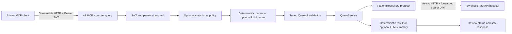

# V2 synthetic integration path

V2 is a portfolio demonstration with synthetic data. It does not implement or
validate real hospital contracts and does not establish clinical correctness.
The older `server.py`, `api_demo.py`, and `client/` paths are retained as
**development-only legacy examples**. Deploy only `v2.mcp_server` and
`v2.synthetic_api`; the v2 server exposes just `execute_query`.



## Offline demo

The Compose demo uses a fixed **synthetic-only** JWT secret so no API key is
needed. Do not use that setting with real records. Both containers run as an
unprivileged user. The hospital API listens on local port 8081, and the MCP
Streamable HTTP endpoint is `http://127.0.0.1:8000/mcp`.

```powershell
docker compose -f compose.v2.yml up --build -d
$env:V2_DEMO_MODE = "true"
uv run --locked python -m v2.demo_token
Invoke-RestMethod http://127.0.0.1:8081/health
```

Pass the generated short-lived token to an MCP client as
`Authorization: Bearer <token>`. Request `Come sta il paziente 101?` or
`Diagnosi ICD-9-CM 250.00`. On Windows without Docker, run
`uv sync --locked --extra dev`, set `V2_DEMO_MODE=true`, then start
`python -m v2.synthetic_api` and `python -m v2.mcp_server` in separate terminals.

## Decisions and boundaries

- Authentication is mandatory for patient reads. JWTs require a valid signature,
  issuer, audience, expiry, subject, and `patient:read` permission. The same
  token is forwarded to the synthetic REST API, which verifies it again.
- The input guardrail is enabled by default and may be disabled explicitly for
  controlled experiments. Authorization and typed validation remain mandatory.
- The deterministic parser supports patient status, patient summary, and exact
  ICD-9-CM cohort filtering. The optional LLM parser must still produce a valid
  `QueryIR`; unknown requests require clarification. Code patterns are numeric
  examples, not a verified clinical terminology service.
- Without an LLM, summaries are simple deterministic sentences. With an
  OpenAI-compatible provider configured, summaries are marked for human review.
  There is no calibrated confidence score and no claim of clinical safety.
- The HTTP client is created per MCP call and closed with the call. This is
  simple and avoids global state; a shared lifecycle-managed client would be
  preferable after load testing.
- Existing legacy tools remain in the repository for learning and comparison.
  Do not expose the legacy server to production callers: its raw tools still
  bypass the v2 canonical path.

## Public material review

`docs/meeting_notes_2026_05_06.md` was retained and de-identified in this
branch. It describes technical direction and contains no patient records or
credentials. The older commit history remains public; this branch does not
rewrite history. The mock patient fixture is empty, and the v2 API uses
explicitly synthetic records. Continue reviewing any new sample data, logs,
and documentation before publication.

## Remaining integration work

Real Agile/Aria API paths, JWT trust configuration, claims, data schemas,
pagination semantics, and deployment security must be agreed with the
organization before connecting actual systems. No real patient data should be
sent to the optional LLM adapter without a separate privacy design and approval.

